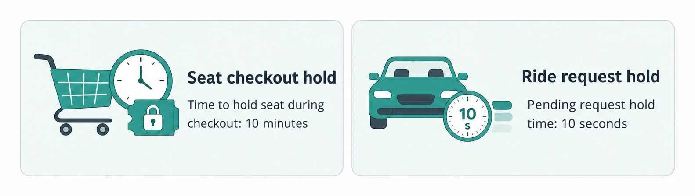

# Dealing with Contention

> **Quick Reference** for [DealingWithContention](../DealingWithContention.md) — condensed cheat-sheet.

## Recognition Signals

- **One winner.** Two buyers want the same seat, two bidders want the same item, or two riders want the same driver.
- **Duplicate claims.** Retried requests could charge a payment twice or book the same meeting room twice.
- **Concurrent edits.** Two updates to a balance, inventory count, or shared document can overwrite each other.
- **Commit order.** Requests arriving on different servers can produce different outcomes depending on which write commits first.

## Selection Ladder

1. **Conditional write.** Start here when the check fits in the write’s `WHERE` clause. The database checks and updates the row atomically.
2. **Pessimistic locking.** When the app must read before deciding what to write and conflicts are frequent, lock the rows while making the decision.
3. **Optimistic concurrency control.** When the app must read before deciding but conflicts are rare, check the row version at write time and retry if it changed.
4. **Serializable isolation.** When concurrent writes to different rows can together break a rule, use a serializable transaction and retry if the database aborts it.
5. **Distributed lock or reservation.** When a hold must outlast a transaction, such as during checkout, give the reservation an expiry time.

## Isolation Levels

- **READ COMMITTED**: Sees only committed changes; default in PostgreSQL.
- **READ UNCOMMITTED**: Can see uncommitted changes from other transactions; rarely used.
- **REPEATABLE READ**: Repeated reads within a transaction stay consistent.
- **SERIALIZABLE**: Strongest isolation; catches write skew by aborting one transaction.

## Common Pitfalls

- **Issuing a ticket after a failed claim.** A conditional update can succeed as a SQL statement while changing zero rows. In the same transaction, insert the ticket only if the claim updated one seat. If it updated none, tell the buyer the seat is unavailable.
- **Guarding the wrong row.** Two buyers can both decrement a concert’s remaining capacity and still pick A15. Claim the row identified by the concert and seat number, with availability as a condition of the write.
- **Holding a lock through payment.** A slow payment call makes other buyers wait on the seat lock. Commit a short-lived reservation first. Finalize the sale only if the same reservation still owns the seat and is unexpired.
- **Taking locks in opposite orders.** Transfers from A to B and B to A can each hold the row the other needs. Acquire both account locks in account-ID order on every transfer path. If the database aborts a deadlock victim, retry its whole transaction.
- **Missing a change because the value changed back (ABA).** Stock can go from 1 to 0 and back to 1 between a cart’s read and write. If the decision depends on the original read still being current, compare a version counter and increment it on every relevant write.
- **Checking each row while breaking a rule across rows.** Two on-call engineers can each see the other on duty and update different rows, leaving nobody on call. Use serializable isolation and retry aborted transactions, or make both updates lock the same schedule row before checking coverage.
- **Trusting an expired lease.** A paused worker can resume after another worker acquires its lease. If one database owns the resource, enforce the claim there. For an external resource, use a fencing token when the resource can record the newest token and reject older writes.

## Distributed Locks

### Lease Stores

- **Redis with TTL**: SET NX plus TTL is fast and auto-expires; a stalled holder can overlap the next lease.
- **Database columns**: reserved_by and reserved_until claim row if free or expired; no new infrastructure.
- **ZooKeeper/etcd**: Strong consensus coordination with robust failure handling; operationally complex.

### TTL Examples

- **Seat checkout hold**: 10 minutes: held while the user enters payment details.
- **Ride request hold**: 10 seconds: stale pending_request reads as free.

## Interview Moves

| Scenario | What must stay true? | How to enforce it | If requests race or repeat |
| --- | --- | --- | --- |
| Auction bids | Each accepted bid raises the price while the auction is open. | Update the auction row only if bidding is open and the offer exceeds the current high bid. Record the bid in the same transaction. | If the update matches zero rows, return the current price and auction status so the bidder can decide whether to bid again. |
| Ticket checkout | Each seat can be sold once per show. | Claim the seat on selection with a reservation ID and expiry. At checkout, sell it only if that reservation is still active. | A late payment callback must pass the same check. If payment succeeded after the hold was lost, void or refund it. |
| Account transfers | The debit and credit for a completed transfer must both be recorded exactly once. | Within one database, lock both accounts in ID order, check funds, and post both entries under a unique transfer ID in one transaction. | On a duplicate request, return the recorded outcome. If accounts span independent stores, explain how to coordinate commit or keep the transfer pending during reconciliation. |
| Ride dispatch | A driver can have only one active offer. | Claim an available driver with an offer ID and deadline before notifying the rider or driver. | Accept only the current, unexpired offer ID. A delayed response to an old offer cannot take the driver from a newer match. |
| Flash-sale stock | Confirmed purchases plus active holds must fit within stock. | Decrement available stock only if enough remains, and create the cart hold in the same transaction. | Checkout and expiry both claim the active hold. Only the winner can confirm it or return its units to stock. |
| One hot item | Commands for the item must take effect in order, once each. | Route the item’s commands to one ordered partition. Its consumer commits each state change and command ID together before acknowledging delivery. | After a crash, the next consumer can skip committed command IDs on replay. A single hot item is still limited by one consumer’s throughput. |
