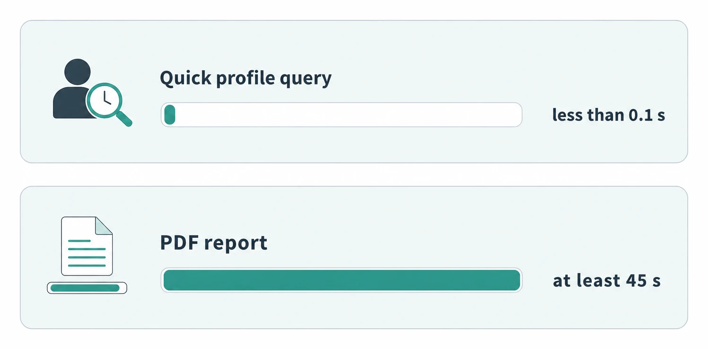
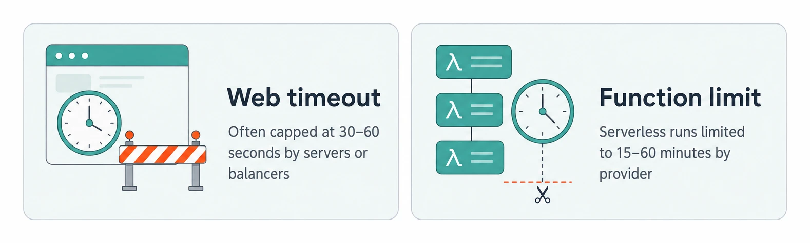

# Managing Long Running Tasks

> **Quick Reference** for [ManagingLongRunningTasks](../ManagingLongRunningTasks.md) — condensed cheat-sheet.

## Decision Triggers

- **Response time.** If work takes more than a few seconds and the caller can wait for the result, return a job ID and process it asynchronously.
- **Workload.** Video transcoding, image processing, PDF generation, bulk email, and CSV imports or exports are common examples.
- **Capacity.** Multiply the arrival rate by the average processing time to estimate how many jobs will run concurrently. Put GPU, CPU, or memory-intensive jobs on a worker fleet.
- **Operating cost.** Keep short requests synchronous when they fit the web tier. A background job adds a queue, workers, status tracking, retries, and monitoring.

## Request Flow

1. **Create the job.** The web server validates the request and saves a pending job record.
2. **Enqueue the job ID.** Keep the full job details in the database.
3. **Return the ID.** The client can check progress while the job runs.
4. **Claim the work.** A worker takes the message, fetches the job details, and marks the job as processing.
5. **Save the result.** The worker writes output files to object storage or saves result metadata in the database.
6. **Record the outcome.** Mark the job as completed or failed so clients can see its status or receive a notification.

## Core Components

### Queue Choice

![Kafka is the default interview pick unless constraints apply, with replay, fan-out, retention, huge volume, and partition ordering. Redis with Bull or BullMQ is startup-friendly with retries, delayed jobs, and priorities, but has memory-first durability tradeoffs. AWS SQS is managed and scalable with guaranteed delivery, but its 1 MB limit means passing IDs instead of full job data. RabbitMQ supports complex routing and enterprise workflows, but self-hosting adds cluster, upgrade, and disk monitoring work.](assets/aa3cd63cf82688fa-03e770112359060f.png)

- **Kafka**: Default interview pick unless constrained; replay, fan-out, retention, huge volume, partition ordering.
- **Redis with Bull/BullMQ**: Startup-friendly retries, delayed jobs, and priorities; memory-first durability tradeoff.
- **AWS SQS**: Managed scaling and delivery; 1 MB message limit means pass IDs, not full job data.
- **RabbitMQ**: Complex routing and enterprise workflows; self-hosting adds cluster, upgrade, disk monitoring.

### Worker Runtime

- **Normal servers**: Default for interviews; full control, easy debugging, and support for long jobs.
- **Serverless functions**: Autoscale and pay per execution; constraints include cold starts and minimal local storage.
- **Container-based workers**: Kubernetes or ECS middle ground; more complex than servers, more flexible than serverless.

## Key Time Numbers

### Job Latency Reference

- **Profile fetch.** Less than 0.1 seconds in the synchronous example.
- **Annual report.** At least 45 seconds in the report generation example.

### Platform Timeout Constraints

- **Web timeout**: Web servers and load balancers often enforce 30-60 second limits.
- **Function limit**: Serverless executions are limited to 15-60 minutes, depending on provider.

### Operational Tuning Values

- **Worker failure detection.** The guide uses 10–30 seconds as a starting interval. Tune it to how long a job can wait for recovery after its worker stops responding.
- **Retry limit.** After 3–5 unsuccessful attempts, send the job to a dead-letter queue for investigation.

## Pitfalls and Fixes

- **Worker crash**: Use heartbeats; queue retries the job when the worker stops checking in.
- **Duplicate work**: Use idempotency keys; return the existing job ID for the same operation.
- **Queue overload**: Set queue depth limits; reject with system busy instead of accepting doomed work.
- **Mixed workloads**: Separate fast and slow queues to prevent long jobs from blocking short jobs.
- **Job dependencies**: Chain simple steps; use Step Functions, Temporal, or Airflow for complex workflows.
