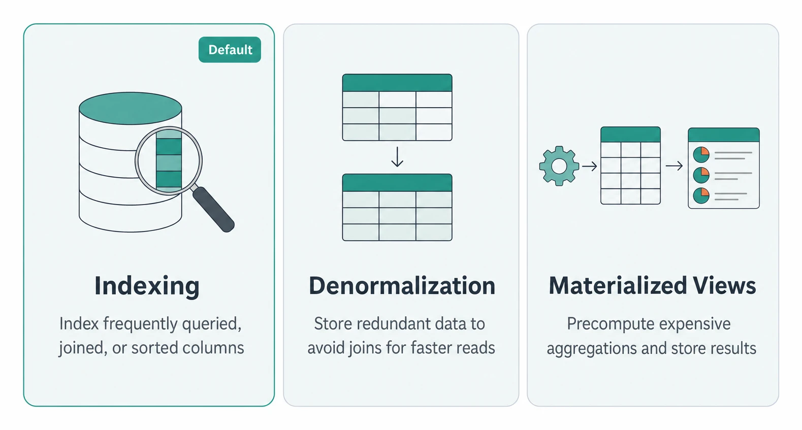
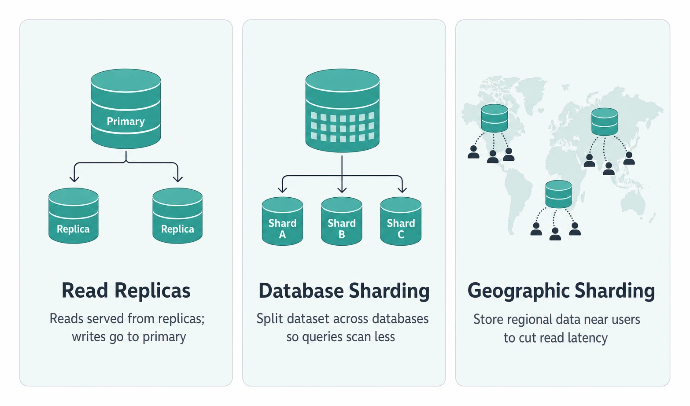
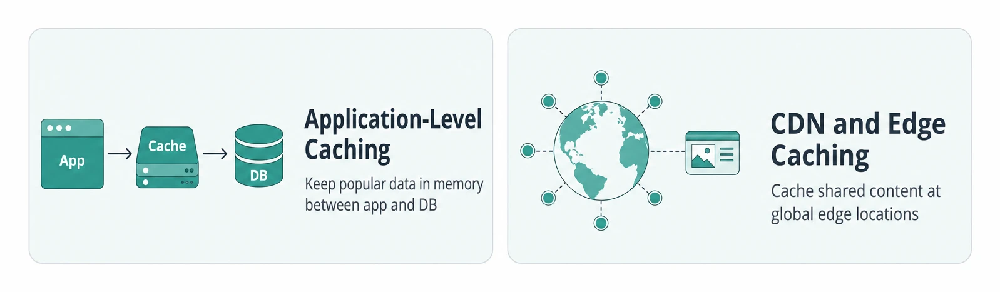
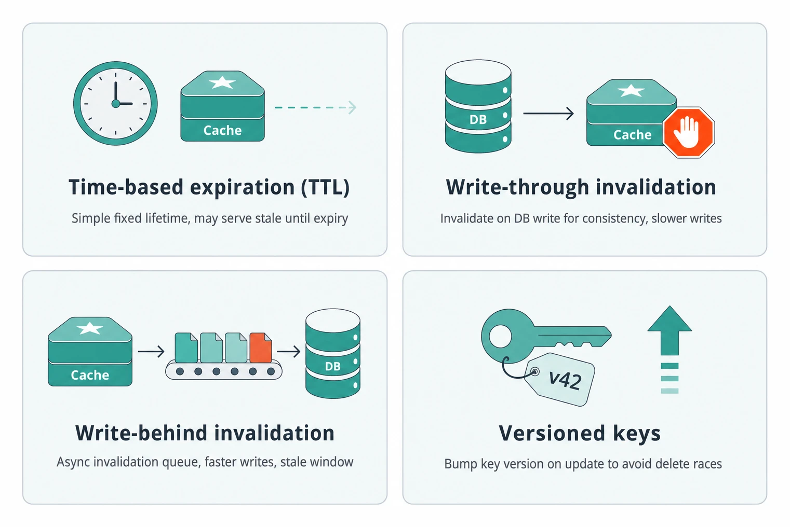
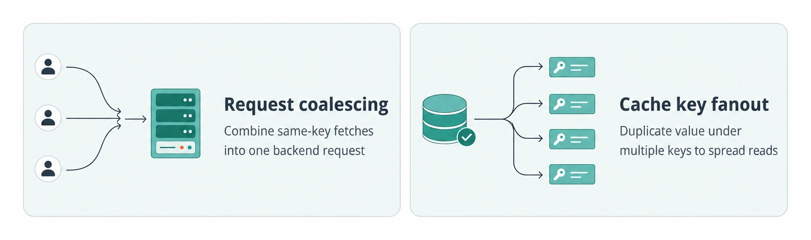
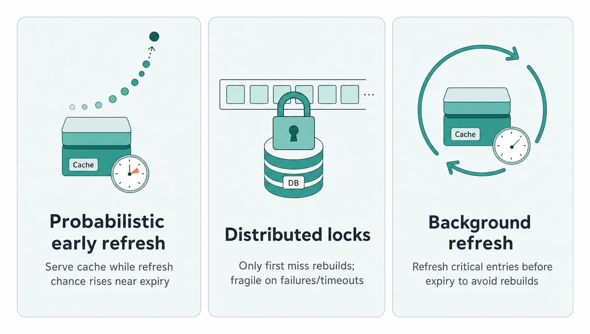
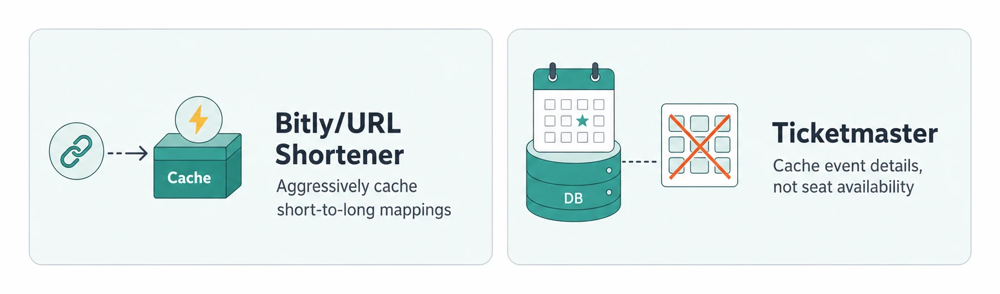

# Scaling Reads

> **Quick Reference** for [ScalingReads](../ScalingReads.md) — condensed cheat-sheet.

## Read Scaling Decisions

### When To Apply

- **Repeated reads.** Look for busy endpoints where many people request the same data, such as an event page before tickets go on sale.
- **Database capacity.** For a small app or a workload closer to one or two reads per write, measure peak read load and query latency before adding infrastructure.
- **Freshness requirements.** Identify which reads must see the latest write, such as a balance check, a seat claim, or a collaborator’s latest edit.

### Scaling Progression

1. **Optimize the database.** Inspect the slow query’s execution plan. Index the columns it filters or joins on, and consider denormalizing data when the same join dominates read cost.
2. **Distribute database reads.** Send reads that tolerate lag to replicas when one server runs out of read capacity. Consider sharding when queries can target a partition and the dataset has outgrown one server.
3. **Cache repeated reads.** Use an application cache for frequently requested records or a CDN for public content shared across users. Choose an expiry that fits how long readers can tolerate stale data.

## Key Numbers

- **Read/write ratio.** At 10:1, each write corresponds to ten reads on average. A content-heavy workload can reach 100:1 or higher.
- **Peak throughput.** At 50,000–100,000 reads per second, compare peak demand with the database’s measured capacity and check how much traffic targets the same keys.
- **Cache latency.** An in-memory lookup can take under 1 ms while a database query can take tens of milliseconds. Include network time when comparing what the caller sees.
- **Edge latency.** In the Tokyo example, serving a request locally cuts a roughly 200 ms round trip to Virginia to under 10 ms.
- **Cache lifetime.** A 5–15 minute TTL is an example for data that can be stale that long. Invalidate on writes when updates need to appear sooner.

## Database Optimization

- **Indexing**: Default first move; index columns frequently queried, joined, or sorted.
- **Denormalization**: Store redundant data to avoid joins; faster reads, more complex writes.
- **Materialized Views**: Precompute expensive aggregations in background and store the results.

## Horizontal Scaling

- **Read Replicas**: Writes go to primary and reads to replicas; distributes load but can lag.
- **Database Sharding**: Split large datasets across databases so each query scans less data.
- **Geographic Sharding**: Store regional data near users to reduce global read latency and load.

## Cache Strategy

### Cache Layers

- **Application-Level Caching**: Redis or Memcached between app and DB; popular data stays in memory.
- **CDN and Edge Caching**: Cache shared content at global edge locations; skip user-specific data.

### Invalidation Choices

- **Time-based expiration (TTL)**: Fixed lifetime; simple, but stale data may serve until expiration.
- **Write-through invalidation**: Update or delete cache on DB write; consistent but adds write latency.
- **Write-behind invalidation**: Queue invalidations asynchronously; lowers write latency but opens a stale window.
- **Versioned keys**: Change key version on update; avoids delete races but needs version tracking.

## Failure Modes

### Hot Key Fixes

- **Request coalescing**: Combine same-key fetches; backend gets one request per app server.
- **Cache key fanout**: Store identical copies under multiple keys; spreads one hot key across caches.

### Stampede Fixes

- **Probabilistic early refresh**: Smarter than locks; refresh chance rises near expiry while serving cached data.
- **Distributed locks**: Only first miss rebuilds; fragile if rebuild fails or waiters time out.
- **Background refresh**: Continuously refresh critical entries before expiration so users never rebuild.

## Interview Scenarios

- **Bitly/URL Shortener**: Cache short-to-long mappings aggressively; URLs do not change.
- **Ticketmaster**: Cache event details, not seat availability; use replicas for browsing.
